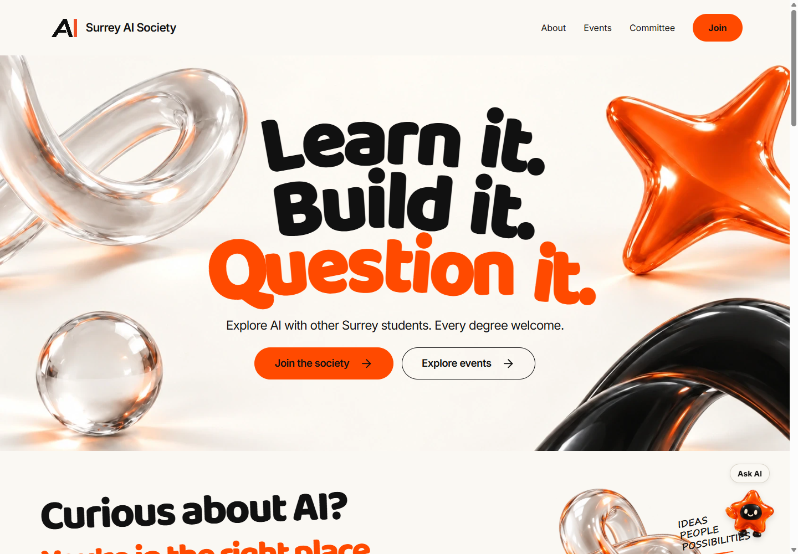

# Surrey Societies

Three student communities at the University of Surrey, each with a website of its own. Discover what they do, explore events and find your way to get involved.

[AI Society](https://surreyaisociety.org) · [Business Society](https://surreybusinesssociety.org) · [Neurotech Society](https://surreyneurotechsociety.org)

## AI Society

A community for students curious about artificial intelligence, machine learning and data science. Learn together, build projects and ask questions, whatever your degree or experience.

[Visit the AI site →](https://surreyaisociety.org)



## Business Society

Meet Surrey’s business community through careers, enterprise, networking and practical skills. A place to exchange ideas, meet other students and take your next step.

[Visit the Business site →](https://surreybusinesssociety.org)


## Neurotech Society

Explore where neuroscience meets technology through workshops, brain–computer interface projects, research discussions and socials. No previous experience needed.

[Visit the Neurotech site →](https://surreyneurotechsociety.org)


*Screenshots captured from all three live websites on 9 October 2026.*

## About the project

The sites bring each society’s activities, committee and membership links together in one place. Each keeps its own look and personality, with shared foundations that make it easier to maintain all three.

## Contributing

Ideas, corrections and improvements are welcome. Keep society information accurate and check changes on both desktop and mobile. The project’s [working guide](AGENTS.md) covers where things live and which checks to run.

<details>
<summary>For developers: run the sites locally</summary>

Use Node.js 22.12 or newer. Install dependencies, copy [.env.example](.env.example) to `.env` and configure your own Convex project:

```sh
npm install
npx convex dev
```

Start the site you want to work on, then open the address printed in the terminal:

```sh
npm run dev:ai
npm run dev:business
npm run dev:neurotech
```

The sites are in `apps/ai`, `apps/business` and `apps/neurotech`. They share UI packages and a Convex backend, and are published separately on Vercel. Keep credentials private; never use a `PUBLIC_` prefix for secrets.

Before submitting changes, run the relevant build and checks described in [AGENTS.md](AGENTS.md).

### AI committee planner

The AI site has a private board at `/committee/planner` with sign-in only. `joshhknott@gmail.com` has an owner-only Committee access section in dashboard Settings to add or revoke emails. Other accounts require an explicit email grant; society roles alone do not grant board access or access-management permissions. Adding an email prepares its Clerk sign-in account without sending an invitation, so committee members do not register separately. `CLERK_SECRET_KEY` is required on the AI server for adding new emails.

The custom sign-in form checks email access before requesting a Clerk email code, then restores Clerk's browser session on return visits. It does not accept passwords or store application tokens in local storage. Set the same random `PLANNER_SIGN_IN_SECRET` (at least 32 characters) on the AI server and its connected Convex deployment for the server-only access check. Code requests are rate limited by email and a keyed requester hash; raw IP addresses are not stored. Session expiry remains controlled by the existing Clerk session settings.

Ideas start with a title, description and optional collaborators. Planning reveals logistics and optional private notes/checklists; Ready adds the public preview. Existing details are preserved when an item moves back to Ideas. Events and hackathons need a date, start time, room/location and booking link to publish; projects can remain undated. Description assistance is embedded in the editor and only applies a reviewed suggestion to that field.

Ideas, Planning and Ready stay private. **Publish to website** saves a public snapshot and moves an activity to Published. Subsequent draft edits, committee notes, owners and preparation tasks remain private; publish changes explicitly to update the site. Unpublishing or archiving removes the public entry.

Board cards move between columns by drag and drop, with a stage control inside the editor for keyboard and touch access. The calendar is a month grid on desktop and a compact agenda on phones, including archived events. It reads each month's history independently of the active board and archive-list limits. An internal hourly job archives dated events and hackathons once their date has passed in Europe/London; it preserves their dates, collaborators, notes and checklist. Projects and undated ideas stay active. Archived events can still be opened and edited from the calendar or rescheduled to a future date and stage.

Opening a card shows a compact preview and its private comment thread. Choose Edit to change the card's details; closing the editor returns to the preview. Initials avatars identify the creator and people who have edited or moved the card, using authenticated accounts. Commenting does not change the content revision or add an editor avatar. Authors can edit their comments inline or delete them after confirmation; server checks prevent anyone, including the planner owner, changing another person's comments. Edits show an Edited marker and guard against overwriting changes from another tab. Comments are paginated, accept plain text only, survive archiving and are excluded from public snapshots. Existing card attribution can be recovered from server-written audit history with the internal `planner:backfillAttribution` function.

Type `@` in a new or edited comment to choose a committee member by name or email. The editor inserts a canonical `@email` token and the saved comment displays their name. Mentioned people get a private notification in the planner's bell inbox, including if they have not signed in before. The inbox has unread counts, read history and Mark all as read; selecting a notification opens and highlights the comment, including on archived cards. An authenticated Convex subscription updates the inbox and badge live across open tabs, including edits, removals and read receipts. The connection reconnects automatically and closes on sign-out or revoked access; transient refresh failures retry without losing pending changes. Only active committee emails and the owner can be mentioned; self-mentions do not notify. Edits notify newly added people once, keep existing read status, and remove alerts for mentions that are removed. Deleting a comment also removes its notifications. All inbox operations check the recipient's authenticated email and current committee access.

New mentions also queue an email after ten seconds, with the author, card title, a short comment preview and a sign-in-protected link to the exact comment. Existing inbox history is not emailed. Members can switch mention emails off in the notification inbox; in-app alerts remain available. Delivery rechecks the mention, comment, card, current access and email preference before each attempt. Removed mentions and revoked access cancel pending sends; an email already sent cannot be recalled. Temporary failures retry up to six attempts, with a stable Resend idempotency key and frozen email content to prevent duplicate sends. Delivery state is stored privately on the notification (`pending`, `sent`, `skipped` or `failed`).

The Convex background action calls the AI site's `/api/planner-mention-email` relay with a timestamped, domain-separated HMAC using a dedicated shared `PLANNER_EMAIL_SECRET` (at least 32 random characters, set on the connected Convex deployment and AI server). The relay requires the AI server's existing `RESEND_API_KEY` and verified `COMMITTEE_FROM_EMAIL`; these remain on Vercel. Deploy the relay before enabling the backend sender. Never print or commit environment values. No desktop push notifications are sent.

Configure `CONVEX_URL` and the public `PUBLIC_CLERK_PUBLISHABLE_KEY` on the AI app, and the matching `CLERK_JWT_ISSUER_DOMAIN` on that Convex deployment. Clerk must provide its `convex` JWT template. AI drafting additionally uses the existing server-side Gemini configuration; manual planning works independently.

Planner regression checks run with `npm run test:e2e -- --config e2e/planner.config.ts planner.spec.ts`. These tests use temporary Clerk sessions and the real Convex functions in `convex-test`, without adding hosted society data. Public activities are available on the homepage, `/activities`, and the `/programme.ics` calendar feed.

</details>
